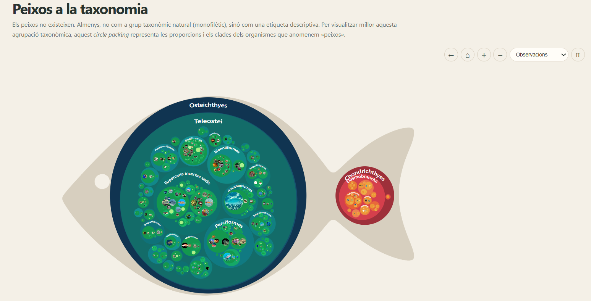
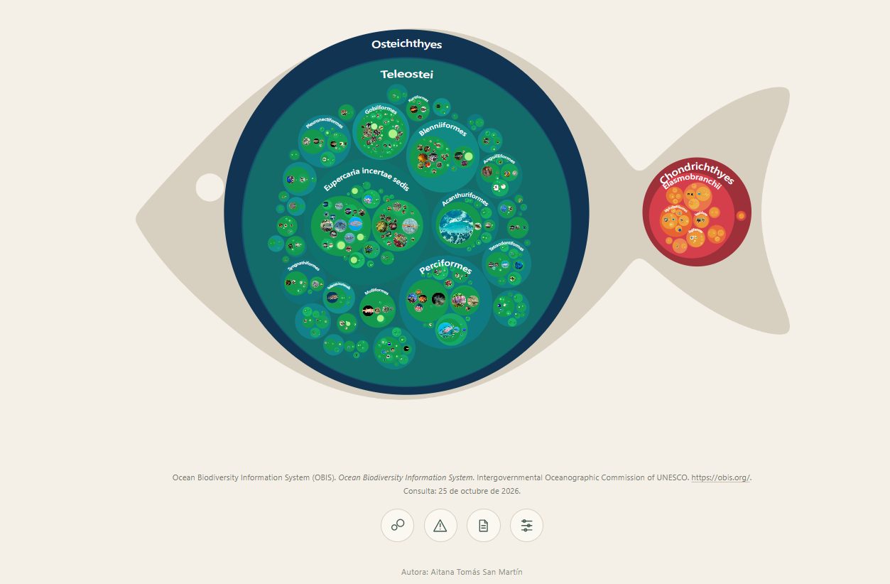

# Peixos a la taxonomia

**Una visualització interactiva de la diversitat taxonòmica dels organismes que anomenem «peixos».**

> **Els peixos no existeixen.** Almenys, no com a grup taxonòmic natural (monofilètic).

Aquest projecte explora aquesta idea mitjançant una visualització *circle packing* construïda amb [D3.js](https://d3js.org/). Els cercles representen grups taxonòmics niats: els grups més grans contenen els seus subgrups, i aquests, al seu torn, contenen grups més específics. La visualització permet explorar com s'organitza aquesta diversitat i veure el pes que tenen els teleostis dins dels registres analitzats.

## La visualització

La visualització és interactiva: pots apropar-te a un grup, tornar a la vista general i canviar la variable representada amb el selector.

- **Espècies:** la mida dels cercles reflecteix el nombre d'espècies representades en cada grup.
- **Observacions:** la mida reflecteix el nombre de registres d'observació associats a cada grup.
- **Zoom i navegació:** selecciona o apropa't als cercles per explorar nivells taxonòmics més detallats.

## Què vol dir «observació»?

Les dades provenen de l'[Ocean Biodiversity Information System (OBIS)](https://obis.org/), una infraestructura internacional que reuneix registres de biodiversitat marina de múltiples fonts.

En aquesta visualització, una **observació és un registre de presència d'un organisme**, no necessàriament un individu únic ni una menció en un article científic. Els registres poden procedir de conjunts de dades i programes de mostreig diferents.

Per tant, un nombre més elevat d'observacions indica que un grup està més representat en les dades disponibles; **no demostra, per si sol, que sigui més abundant al mar**. La representació també depèn de l'esforç de mostreig, la cobertura geogràfica i temporal, la identificació taxonòmica i la disponibilitat de dades.

## Dades i abast

El conjunt processat per al projecte conté:

- **56.687 registres d'observació**.
- **560 rutes taxonòmiques**.
- **51 ordres**.
- Tres classes principals representades en les dades: *Teleostei*, *Elasmobranchii* i *Holocephali*.

Les xifres descriuen el conjunt de dades utilitzat per generar aquesta visualització, no un cens complet de tots els peixos del planeta. La classificació i els registres depenen de les dades disponibles a OBIS i de les decisions de tractament aplicades per preparar el fitxer.

## Font i citació

**Font de les dades:** Ocean Biodiversity Information System (OBIS), Intergovernmental Oceanographic Commission of UNESCO. Consulta de les dades: 25 d'octubre de 2026.

> Ocean Biodiversity Information System (OBIS). *Ocean Biodiversity Information System*. Intergovernmental Oceanographic Commission of UNESCO. https://obis.org/. Consulta: 25 d'octubre de 2026.

Aquesta referència general no substitueix les citacions dels conjunts de dades d'origen. El paquet de descàrrega d'OBIS inclou `citations.html`, que recull les referències, els identificadors i les llicències dels conjunts que poden haver contribuït als registres. Les condicions de reutilització s'han de comprovar per a cada conjunt de dades; no s'ha confirmat una única llicència aplicable a tots els registres de la visualització.

Les fotografies d'espècies es consulten en línia des de fonts com Wikipedia/Wikimedia Commons. La disponibilitat d'imatges depèn de la connexió i dels recursos disponibles per a cada tàxon.

## Estructura del projecte

- `index.html`: estructura principal de la pàgina.
- `css/styles.css`: estils i disseny adaptable.
- `js/main.js`: visualització, jerarquia, interacció i zoom.
- `js/data.js`: dades incorporades que l'aplicació utilitza en executar-se.
- `js/info.js`: botons i panells informatius.
- `data/peces.csv`: còpia del CSV per consultar-lo o reutilitzar-lo.
- `data/descriptions.json`: descripcions taxonòmiques.
- `screenshots/`: captures de pantalla que es mostren en aquest README.

## Autoria

**Autora:** Aitana Tomás San Martín.
